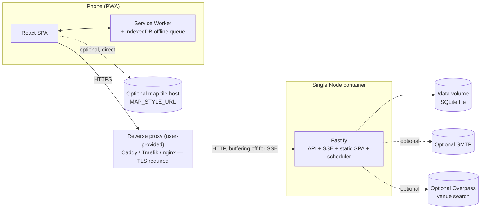

# 01 — Architecture

Read `README.md` first (decisions D1–D14 are binding here).

## 1. System diagram



- TLS terminates at the proxy. Required in production: geolocation (`navigator.geolocation`) and service-worker registration are both restricted to secure contexts.
- Map tiles are fetched directly by the browser from `MAP_STYLE_URL` (not proxied through the app server) unless the operator points it at a same-origin path.
- DECISION: Overpass calls are server-side (not browser CORS) to keep the operator's Overpass endpoint un-exposed and to allow caching/rate-limiting venue lookups.

## 2. Repo layout

```
drunkify/
├── apps/
│   ├── web/                     # Vite + React 19 SPA (PWA)
│   │   ├── src/
│   │   │   ├── routes/          # React Router route modules, one per screen (§5 app structure)
│   │   │   ├── components/      # Presentational + composed components (CSS Modules)
│   │   │   ├── state/           # Zustand stores (UI-only state: wizard step, sheet open, theme)
│   │   │   ├── queries/         # TanStack Query hooks per resource (trips, drinks, feed, …)
│   │   │   ├── sse/             # EventSource client, reconnect/backoff, event dispatch to query cache
│   │   │   ├── offline/         # IndexedDB queue, replay-on-reconnect, service worker messaging
│   │   │   ├── tokens/          # generated CSS custom properties from packages/content tokens.json
│   │   │   └── sw.ts            # vite-plugin-pwa service worker entry
│   │   ├── index.html
│   │   └── vite.config.ts
│   ├── server/                  # Fastify API
│   │   ├── assets/              # common-passwords-10k.txt (README C15)
│   │   └── src/
│   │       ├── routes/          # HTTP handlers only: parse/validate (Zod), call service, shape response
│   │       ├── services/        # Business logic, orchestrates repos, emits events, no SQL
│   │       ├── repositories/    # Drizzle query factories, one per table/aggregate, no business logic — instantiated by createDb(), not module-level singletons
│   │       ├── db/
│   │       │   ├── schema.sqlite.ts  # Drizzle schema, SQLite dialect (02 §3)
│   │       │   ├── schema.pg.ts      # Drizzle schema, Postgres dialect (02 §3)
│   │       │   └── createDb.ts       # createDb(config): branches once at boot on DB_DRIVER (§5) — no schema.ts re-export
│   │       ├── jobs/            # Scheduler + individual job handlers (see §7)
│   │       │   └── scheduler.ts
│   │       ├── events/
│   │       │   └── bus.ts       # in-memory pub/sub, SSE channel fan-out
│   │       ├── mailer/          # log | smtp implementations behind one interface
│   │       ├── geo/             # GeoNames lookup, Overpass client, venue matching (~150m); vendored cities15000.min.json asset generated by scripts/build-geonames.ts (§9)
│   │       ├── auth/            # session, argon2, invite/reset token logic
│   │       ├── cli/             # `drunkify` CLI entry (admin reset-link, admin set-email, db backup, db migrate — full ref: 04-auth-accounts.md §3)
│   │       ├── config.ts        # Zod-validated env parsing, fail fast
│   │       ├── logger.ts        # pino instance + redaction config
│   │       └── app.ts           # Fastify instance assembly (plugins, routes, static, SSE)
│   │       └── server.ts        # process entrypoint: config → createDb → migrate → seed → listen → scheduler.start()
├── packages/
│   ├── shared/                  # Pure TS, zero DB/IO deps: Zod schemas (API contracts), std-drink calc,
│   │                             # ABV slider math, phase/day calc, achievement predicates, metrics formulas
│   └── content/                 # Copied verbatim from design/: tokens.json, themes/*.json, content/auth.json,
│                                 # data/catalog.json, icons/ — content-pack loader + key-parity lint
├── drizzle/
│   ├── sqlite/                  # drizzle-kit generated SQL migrations, SQLite (02 §3)
│   └── pg/                      # drizzle-kit generated SQL migrations, Postgres — CI-smoke only (02 §5)
├── drizzle.config.ts            # parameterised by DB_DRIVER; points schema + migration out dir at the matching pair
├── scripts/                     # seed.ts (fixture generator), build-geonames.ts + geonames.lock.json (§9, run once, not part of the Docker build), one-off maintenance scripts
├── docker/
│   ├── Dockerfile
│   └── Caddyfile              # the actual mounted config (§8/§9), not a .example an operator forgets to copy
├── e2e/                          # Playwright specs + fixtures (mobile viewport, geolocation mocks)
├── docker-compose.yml
├── .env.example
└── pnpm-workspace.yaml
```

## 3. Layering rules

- `routes/` → `services/` → `repositories/` → `db/`. Routes never import Drizzle/db directly. Services never import Fastify types.
- `packages/shared` has **no DB, no Fastify, no Node-only APIs** — must run in both server and browser (Vitest + browser bundle). Enforced by `eslint` import boundary rule (`no-restricted-imports` on `apps/server/**` from `packages/shared`, and vice versa for `better-sqlite3`/`pg`/`fastify`).
- `packages/content` is data + a loader (pure, sync `JSON.parse` + Zod validation), no runtime fetch.
- Cross-cutting concerns (auth session lookup, request-id) live in Fastify `onRequest`/`preHandler` hooks in `app.ts`, not sprinkled into route handlers.
- Jobs and event emission call the **same services** routes call — no duplicate business logic paths.

## 4. Config

Zod-validated on boot (`config.ts`); process exits non-zero with a clear message on validation failure (fail fast, no partial start).

| Var | Default | Required | Description |
|---|---|---|---|
| `NODE_ENV` | `development` | no | `development` \| `production` \| `test` |
| `PORT` | `3000` | no | HTTP listen port |
| `PUBLIC_URL` | — | yes (prod) | Externally-visible origin, e.g. `https://drunkify.example.com`; used for invite/reset links, cookie domain inference |
| `DATA_DIR` | `/data` | no | Base dir for SQLite file, logs-on-disk (none by default), backups |
| `DB_DRIVER` | `sqlite` | no | `sqlite` \| `postgres` |
| `DATABASE_URL` | — | if `DB_DRIVER=postgres` | Postgres connection string |
| `SQLITE_PATH` | `${DATA_DIR}/drunkify.db` | no | SQLite file path (only used if `DB_DRIVER=sqlite`) |
| `ADMIN_EMAIL` | — | yes (prod) | Seed admin email (DS §6.13 seeding) |
| `ADMIN_PASSWORD` | — | no | If unset, random 20-char OTP generated + logged once |
| `SESSION_COOKIE_NAME` | `drunkify_session` | no | Cookie name (README C1) |
| `COOKIE_SECURE` | `true` | no | Set `false` only for local HTTP dev |
| `TRUST_PROXY` | `false` | no | Set `true` behind Caddy/Traefik/nginx so `req.ip`/protocol are correct |
| `MAILER` | `log` | no | `log` (stdout) \| `smtp` |
| `SMTP_HOST` | — | if `MAILER=smtp` | — |
| `SMTP_PORT` | `587` | no | — |
| `SMTP_SECURE` | `false` | no | STARTTLS vs implicit TLS |
| `SMTP_USER` | — | if `MAILER=smtp` | — |
| `SMTP_PASS` | — | if `MAILER=smtp` | — |
| `MAIL_FROM` | `Drunkify <no-reply@localhost>` | no | From header |
| `GEO_VENUE_PROVIDER` | `none` | no | `overpass` \| `none` |
| `OVERPASS_URL` | `https://overpass-api.de/api/interpreter` | if `GEO_VENUE_PROVIDER=overpass` | Self-hostable; operator should point at their own instance for trip-day load |
| `MAP_STYLE_URL` | `https://tiles.openfreemap.org/styles/liberty` | no | MapLibre style JSON URL (OpenFreeMap liberty — no API key) |
| `MAP_CSP_ORIGINS` | `https://tiles.openfreemap.org` | no | Comma-separated list of additional origins (tile/glyph/sprite hosts) merged into CSP `connect-src`/`img-src` for MapLibre when they differ from `MAP_STYLE_URL`'s own origin (04-auth-accounts.md §16) |
| `LOG_LEVEL` | `info` | no | pino level |
| `TZ` | — | no | Container OS timezone; **does not affect app logic** — all trip-day math uses the trip's stored IANA `timezone` (README §4), never process TZ. Set for readable container log timestamps only. |

`.env.example` ships all of the above with defaults commented, `ADMIN_EMAIL`/`PUBLIC_URL` blank and flagged `# required`.

## 5. DB abstraction (Drizzle)

- **One Drizzle schema file per dialect** (`apps/server/src/db/schema.sqlite.ts`, `schema.pg.ts`), not a shared dialect-agnostic builder (02 §3: `sqlite-core`/`pg-core` diverge enough on primitives — boolean, timestamp, jsonb, autoincrement — that abstraction isn't worth it, and Postgres is CI-smoke-only). Both export identically-named tables/types; **no runtime re-export** — a single `schema.ts` cannot conditionally re-export one of two modules based on an env var read at import time and still work correctly across one build artifact (module graphs are static). Instead `db/createDb.ts` exports `createDb(config)`, called **once at boot** (`server.ts`, before `migrate()`): it branches on `config.DB_DRIVER` and returns a dialect-specific Drizzle instance (`better-sqlite3` + `drizzle-orm/better-sqlite3`, or `pg` + `drizzle-orm/node-postgres`) plus the repository factories closed over it. Both schema files are compiled into every build (no dynamic `import()`); exactly one branch executes at runtime. Routes/services receive `db`/repositories via DI (constructor arg or Fastify decoration) — never a module-level singleton import. A Vitest suite asserts both schema files declare the same table/column names.
- Repositories are written against Drizzle's query builder only — no raw SQL, no driver-specific SQL functions — so the same repository factory code runs against either dialect instance `createDb` hands it.
- DECISION: **Postgres is a CI smoke target, not a v1 support target.** CI runs the full migration + a minimal integration smoke suite (auth, one trip, one drink, one SSE event) against a Postgres service container. Full test suite (unit + integration + e2e) runs against SQLite only. Docs, ops runbook (backup/restore) and Docker Compose default to SQLite.
- Migrations: `drizzle-kit generate` (dialect-specific) checked into `drizzle/sqlite/` / `drizzle/pg/` (02 §3); `drizzle.config.ts` is parameterised by `DB_DRIVER` and points `schema` + migration `out` dir at the matching pair. Applied on boot (`server.ts` runs `migrate()` before `listen()`).

## 6. Realtime (SSE)

Three channels (README C13, 03-api.md §20), all `GET`, `text/event-stream`, auth via session cookie:

| Channel | Auth | Scope |
|---|---|---|
| `/api/v1/trips/:tripId/events` | trip member | main trip stream |
| `/api/v1/me/events` | session | personal, cross-trip (`session.revoked`) |
| `/api/v1/admin/events` | admin | admin-wide (`invite.accepted`) |

Client opens `/me/events` once at app-shell load (always), `/admin/events` additionally when `role='admin'`, and one `/trips/:tripId/events` per currently-viewed trip. No piggybacking of personal/admin events onto the trip channel.

- Event envelope: `{ id: <monotonic per-channel seq>, event: <type>, data: {...} }` (SSE `id:`/`event:`/`data:` fields).
- On connect, each channel emits a `hello { serverTime }` event first (README C13) — clock-skew calibration, same purpose as the `serverTime` field on REST responses (03-api.md §1.4).
- Event types: per `03-api.md` §20, plus `member.removed` (trip channel, README C13) when an admin removes a member's access.
- Heartbeat: comment ping (`:hb\n\n`) every **25 s** to defeat idle-timeout proxies/LBs.
- DECISION: **no replay buffer.** On reconnect (`EventSource` auto-retry or app-level backoff), client does **not** rely on `Last-Event-ID`; it refetches the relevant TanStack Query keys (feed/leaderboard/trip) on the `open` event instead. Rationale: ring-buffer replay adds state/complexity for a single-instance, small-group (≤~10 members) app where a refetch is cheap and always correct; avoids subtle gap bugs. `Last-Event-ID` header is accepted and ignored server-side (forward-compatible no-op).
- Reverse-proxy buffering gotchas (document in Caddyfile/nginx example):
  - Response header `X-Accel-Buffering: no` (nginx) set by Fastify on the SSE route.
  - Caddy: `flush_interval -1` on the reverse_proxy directive for the `/api/v1/*/events` path.
  - Disable gzip/compression middleware on the SSE route (`Content-Encoding` must not apply).
  - Fastify: `reply.raw.flushHeaders()` before writing, `Connection: keep-alive`, no default compress plugin on this route.
- Client reconnect/backoff: exponential 1s→30s cap, jittered; on `visibilitychange` back to visible, force reconnect + refetch.

## 7. Scheduler & background jobs (README D14)

In-process, single Node instance, `setInterval`-based scheduler (`jobs/scheduler.ts`) with per-job try/catch + pino error log (one job failing must not kill others or the process).

| Job | Interval | Purpose |
|---|---|---|
| `phaseTransition` | **15 s** (README C26 — canonical cadence; supersedes any other interval mentioned elsewhere) | Recompute each active trip's phase (`live`/`final_24h`/`wrapped_unlocked`/`ceremony` — README C2). The transition marker is written **in the same transaction** as any snapshot work that transition triggers — never before it (C26): a crash between marking the transition and doing the snapshot work must not permanently suppress a retry. `phase.changed` SSE emitted after commit. |
| `personalSnapshotCompute` | driven by the `phaseTransition` tick above (same 15 s cadence, same txn as the marker) | Compute + persist **personal** `wrapped_snapshots` per member at `unlock_at`, idempotent upsert (README C11). **Boot backfill**: on startup, before accepting traffic, backfill any trip whose `unlock_at` has already passed but has no persisted transition marker/snapshot (crash/restart safety) — no separate safety-poll interval; the 15 s tick plus boot backfill is the whole mechanism. |
| `sessionCleanup` | 1 h | Sessions are soft-revoked (`sessions.revoked_at`), never deleted by sign-out/password-change/reset/remove-access (04-auth-accounts.md §5); auth already rejects any revoked or expired session. This job hard-deletes rows whose `expires_at` **or** `revoked_at` is more than 30 days in the past (README C39) — the only place a session row is actually removed. |
| `rateLimitGc` | 5 min | Sweep in-memory rate-limit buckets (only if `rate_limit_events` not backed by DB) |

DECISION: scheduler ticks are cheap polls (trip/job counts are tiny — one friend group's trips); no cron library needed, plain `setInterval` + jitter to avoid thundering herd on restart.

**Moving `unlock_at`** (pre-ceremony, README C26): the trip-settings update that changes `unlock_at` re-derives — clears and recomputes — both the phase-transition marker and any already-set personal-snapshot completion marker for that trip in the same transaction as the `unlock_at` write, so pushing the unlock time later doesn't leave a stale "done" marker from the old time, and pulling it earlier doesn't skip the tick that would have computed it.

Wrapped snapshot compute (README C11):
- **Personal**: `personalSnapshotCompute` above computes it proactively at `unlock_at`. Any drink/prediction mutation on that trip before ceremony start marks its personal snapshots stale; the next `GET /wrapped/personal` recomputes lazily (synchronously, in-request — README C38) and persists a new `revision` (README C24; there is no separate `version` column) — not handled by a scheduler job.
- **Squad**: computed synchronously inside `POST /trips/:tripId/ceremony/start` (03-api.md §17), not polled — frozen at ceremony start and never recomputed.
- Invites and password resets are **not** scheduler-cleaned: invite rows are never deleted (README C5 — "expired" and "hidden after 30 days" are both query-time, not stored transitions), and reset rows are superseded (not deleted on a timer) when a new one is issued for the same user (02 §5.4).

## 8. Logging, health, errors

- **Logging**: pino, JSON lines to stdout. Redact `req.headers.cookie`, `req.headers.authorization`, `body.password`, `body.token`. `LOG_LEVEL` env-controlled. Request logging via `fastify.log` (pino built-in), one line per request with `reqId`, `statusCode`, `responseTime`.
  - **P0 — token path-segment redaction**: the request logger's `url` serializer additionally matches the `:token` segment of `/i/:token`, `/r/:token`, `/api/v1/invites/lookup/:token`, and `/api/v1/auth/reset-password/:token` and replaces it with `[redacted]` before the line is written — these tokens sit in the URL, not the body/headers, so the generic redaction list above doesn't catch them. Applies to every log line derived from `req.url` (access log, error log, any middleware that logs the path).
  - **Reverse-proxy access logs are a separate log stream** (Caddy/nginx/Traefik write their own access log, outside pino) and need their own redaction — document this explicitly so an operator doesn't assume the app-level fix covers it. The tokens live in the **path** (`/i/:token`, `/r/:token`, `/api/v1/invites/lookup/:token`, `/api/v1/auth/reset-password/:token`), not a query string, so a query-field replace (e.g. Caddy's `replace <field> <value>` on a `uri query` filter) never matches and silently no-ops — don't ship that. Instead, skip access logging entirely for these routes via a path matcher (Caddy ≥2.8, `docker/Caddyfile`):
    ```
    drunkify.example.com {
        @tokenRoutes path /i/* /r/* /api/v1/invites/lookup/* /api/v1/auth/reset-password/*
        log_skip @tokenRoutes

        reverse_proxy app-prod:3000 {
            flush_interval -1
            header_up X-Forwarded-Proto {scheme}
        }
    }
    ```
    This is the one Caddyfile the `prod` compose profile mounts (§9) — there is no separate example to keep in sync. (nginx/Traefik operators: strip or hash the `:token` path segment in their own access-log format similarly — see 04-auth-accounts.md §16.)
- **Health**:
  - `GET /healthz` — liveness, no deps, always 200 once process is up.
  - `GET /readyz` — checks DB connectivity (`SELECT 1` / Drizzle ping); 200 or 503.
  - Docker `HEALTHCHECK` calls `/healthz`.
- **Errors**: single Fastify `setErrorHandler` maps thrown domain errors (`class DomainError extends Error { code, statusCode, fields? }`) to the shared error envelope (README §4). Unhandled errors → 500, generic `{code: "internal_error"}`, full stack only in server log.

## 9. Docker

DECISION: **`node:22-bookworm-slim`**, not alpine. `better-sqlite3` and `@node-rs/argon2` are native (prebuilt or node-gyp) addons; bookworm-slim (glibc) has broader prebuilt-binary coverage and fewer musl-related native-module surprises than alpine, at a modest image-size cost — worth it for a home-lab image built rarely and pulled rarely. arm64 (Raspberry Pi) is a first-class target via `buildx --platform linux/amd64,linux/arm64`; bookworm-slim has solid arm64 base-image + npm prebuilt-binary support for both native deps.

**Dockerfile outline** (multi-stage):

```dockerfile
# syntax=docker/dockerfile:1
FROM node:22-bookworm-slim AS base
RUN corepack enable
WORKDIR /app

FROM base AS deps
COPY pnpm-lock.yaml pnpm-workspace.yaml package.json ./
COPY apps/web/package.json apps/web/package.json
COPY apps/server/package.json apps/server/package.json
COPY packages/shared/package.json packages/shared/package.json
COPY packages/content/package.json packages/content/package.json
RUN pnpm install --frozen-lockfile

FROM deps AS build
COPY . .
RUN pnpm --filter @drunkify/shared build \
 && pnpm --filter @drunkify/content build \
 && pnpm --filter @drunkify/web build \
 && pnpm --filter @drunkify/server build \
 && pnpm --filter @drunkify/server deploy --prod /out   # P0 fix, see below

FROM base AS runtime
ENV NODE_ENV=production
RUN groupadd -r drunkify && useradd -r -g drunkify -d /app drunkify \
 && mkdir -p /data/backups && chown -R drunkify:drunkify /data
COPY --from=build /out ./
COPY --from=build /app/apps/server/assets ./assets
COPY --from=build /app/apps/web/dist ./dist/public
RUN printf '#!/bin/sh\nexec node /app/dist/cli.js "$@"\n' > /usr/local/bin/drunkify \
 && chmod +x /usr/local/bin/drunkify
USER drunkify
VOLUME /data
EXPOSE 3000
HEALTHCHECK --interval=30s --timeout=3s --start-period=10s --retries=3 \
  CMD node ./dist/cli/healthcheck.js || exit 1
ENTRYPOINT ["node", "./dist/server.js"]
```

- **P0 fix — workspace links must resolve at runtime**: the old Dockerfile copied `apps/server/dist` + a raw `node_modules` out of the monorepo. pnpm's `node_modules` is symlinks into a shared content-addressed store, including symlinks for workspace deps (`@drunkify/shared`, `@drunkify/content`) pointing at `packages/*` — none of that resolves once the tree is copied into a bare runtime image without the rest of the monorepo. `pnpm --filter @drunkify/server deploy --prod /out` instead produces a self-contained directory with real files (not symlinks) for every prod dependency, workspace packages included, and no dev deps — `COPY --from=build /out ./` is now the entire runtime dependency closure. Assets (below) and the web build are copied on top since they live in sibling packages `pnpm deploy` doesn't touch.
- `apps/server/assets/` (`common-passwords-10k.txt`, README C15; `cities15000.min.json`, GeoNames-derived, vendored — see below) is ordinary committed repo content, copied explicitly into the runtime image alongside the `/out` deploy output — it's not part of `apps/server/dist` (TS build output) so the old Dockerfile silently omitted it.
- `/usr/local/bin/drunkify` is a thin launcher on `PATH` so `docker compose exec app-prod drunkify …` (§10, 04-auth-accounts.md §3) works without callers knowing the internal `dist` path.

**GeoNames data** (README D8 — bundled offline city/country lookup):
- **Vendored, not built in CI/Docker.** `apps/server/assets/cities15000.min.json` is a normal committed file, generated **once**, out of band, by `scripts/build-geonames.ts` — there is no `geonames:build` step in the Docker `build` stage above; the asset ships like `common-passwords-10k.txt` does.
- `scripts/build-geonames.ts` downloads one **pinned, dated** dump (GeoNames doesn't version releases, so "latest" is a moving target that must never be fetched at build/boot time), verifies it, and converts it to one row per city: `{city, countryCode, lat, lng, population}` (drops every other GeoNames column).
- `scripts/geonames.lock.json` (checked in) records the source URL, the dump date, and the SHA-256 of **both** the downloaded zip and the generated `cities15000.min.json`. Re-running the script against that pinned URL and diffing both hashes is how a maintainer confirms the committed asset hasn't drifted from its recorded source; pointing at a newer dump is a deliberate, reviewed regeneration, never an automatic build step.
- Attribution: GeoNames data is CC BY 4.0 — attribution text shown in the Account screen's About/footer area (content key owned by `07-frontend.md`).

- Multi-arch build: `docker buildx build --platform linux/amd64,linux/arm64 -t drunkify:latest --push .`
- `better-sqlite3`/`@node-rs/argon2` compiled per-arch automatically by buildx's per-platform build stages (no cross-compile hacks needed on bookworm).

**docker-compose.yml** — two working profiles, not one default that half-assumes TLS. Run exactly one: `docker compose --profile local up -d` or `docker compose --profile prod up -d`.

```yaml
services:
  app-local:
    profiles: ["local"]
    image: drunkify:latest
    build: { context: ., dockerfile: docker/Dockerfile }
    restart: unless-stopped
    ports:
      - "3000:3000"                       # plain HTTP, LAN-facing
    environment:
      NODE_ENV: production
      PUBLIC_URL: http://<lan-ip>:3000    # e.g. http://192.168.1.50:3000 — no TLS in this profile
      COOKIE_SECURE: "false"              # required: cookie would never be sent over plain HTTP otherwise
      ADMIN_EMAIL: admin@example.com
      TRUST_PROXY: "false"                # no reverse proxy in this profile
      MAILER: log
      GEO_VENUE_PROVIDER: none
    volumes:
      - drunkify-data:/data
    healthcheck:
      test: ["CMD", "node", "./dist/cli/healthcheck.js"]
      interval: 30s
      timeout: 3s
      retries: 3

  app-prod:
    profiles: ["prod"]
    image: drunkify:latest
    build: { context: ., dockerfile: docker/Dockerfile }
    restart: unless-stopped
    # no published ports — only `caddy` below is internet/LAN-facing
    environment:
      NODE_ENV: production
      PUBLIC_URL: https://drunkify.example.com
      COOKIE_SECURE: "true"
      ADMIN_EMAIL: admin@example.com
      TRUST_PROXY: "true"                 # Caddy is the trusted edge
      MAILER: log
      GEO_VENUE_PROVIDER: none
    volumes:
      - drunkify-data:/data
    healthcheck:
      test: ["CMD", "node", "./dist/cli/healthcheck.js"]
      interval: 30s
      timeout: 3s
      retries: 3

  caddy:
    profiles: ["prod"]
    image: caddy:2-alpine
    restart: unless-stopped
    ports:
      - "80:80"
      - "443:443"
    volumes:
      - ./docker/Caddyfile:/etc/caddy/Caddyfile
      - caddy-data:/data
      - caddy-config:/config
    depends_on:
      - app-prod

volumes:
  drunkify-data:
  caddy-data:
  caddy-config:
```

- **`local` profile**: plain HTTP on port 3000, `COOKIE_SECURE=false`, no reverse proxy. Note (per §1/§11): `navigator.geolocation` and service-worker registration require a secure context — they work on `http://localhost` but **not** on a LAN IP over plain HTTP, so a phone hitting `http://192.168.x.x:3000` loses geolocation-assisted venue entry and the offline queue's service worker; use `prod` (or a dev tunnel, §12) for full functionality on a phone.
- **`prod` profile**: Caddy terminates TLS and reverse-proxies to `app-prod`; `COOKIE_SECURE=true`, `TRUST_PROXY=true`. This is the profile with a real `Secure` cookie and working geolocation/offline on any device.

**Caddyfile**: use the canonical example in §8 (log-skip matcher for token routes, `reverse_proxy app-prod:3000`) — that's the file `docker/Caddyfile` mounted read-only into the `caddy` service above. Don't hand-roll a second Caddyfile without the `@tokenRoutes`/`log_skip` block or it silently regresses the P0 token-logging fix.

**.env.example**

```
NODE_ENV=development
PORT=3000
PUBLIC_URL=                 # required in production, e.g. https://drunkify.example.com
DATA_DIR=/data
DB_DRIVER=sqlite
SQLITE_PATH=
DATABASE_URL=
ADMIN_EMAIL=                # required in production
ADMIN_PASSWORD=             # optional; random OTP logged if unset
SESSION_COOKIE_NAME=drunkify_session
COOKIE_SECURE=true
TRUST_PROXY=false
MAILER=log
SMTP_HOST=
SMTP_PORT=587
SMTP_SECURE=false
SMTP_USER=
SMTP_PASS=
MAIL_FROM=Drunkify <no-reply@localhost>
GEO_VENUE_PROVIDER=none
OVERPASS_URL=https://overpass-api.de/api/interpreter
MAP_STYLE_URL=https://tiles.openfreemap.org/styles/liberty
MAP_CSP_ORIGINS=https://tiles.openfreemap.org
LOG_LEVEL=info
```

## 10. Ops

**First run**
1. Pick a profile (§9): `docker compose --profile local up -d` (LAN/HTTP, no TLS) or `docker compose --profile prod up -d` (Caddy + TLS) — with `ADMIN_EMAIL` set in `.env`/compose environment either way. Service name is `app-local` or `app-prod` respectively; substitute below.
2. If `ADMIN_PASSWORD` unset: `docker compose logs app-local` (or `app-prod`) `| grep "one-time password"` for the generated OTP (printed once, at seed time only — not recoverable after).
3. Sign in, forced through "Finish setting up" (`mustChangePassword`).

**CLI** (`/usr/local/bin/drunkify` launcher inside the image, §9; invoked via compose exec; full command reference incl. auth-recovery commands: `04-auth-accounts.md` §3)
```
docker compose exec app-prod drunkify admin reset-link       # print single-use admin reset link
docker compose exec app-prod drunkify admin set-email <newEmail>   # update the admin's email directly
docker compose exec app-prod drunkify db backup /data/backups/pre-upgrade.db
docker compose exec app-prod drunkify db migrate             # also runs automatically on boot
```
(swap `app-prod` for `app-local` when running the `local` profile)

**Backups**
- `drunkify db backup <path>` uses `better-sqlite3`'s online backup API (`db.backup(path)`), safe to run against a live DB, no downtime.
- DECISION: Postgres backup is out of scope for the CLI in v1 (operator uses `pg_dump`); note this explicitly since Postgres is CI-smoke-only (§5).
- Cron example (host crontab, outside the container; `app-prod` shown, swap for `app-local`):
  ```
  0 4 * * * docker compose exec -T app-prod drunkify db backup /data/backups/drunkify-$(date +\%F).db
  ```
- **Restore**: `drunkify-data` is a named Docker volume, not a host bind mount, so a host-side `cp ... ./data/drunkify.db` lands nowhere the container can see — never document that. Restore via a throwaway container that mounts the same volume:
  ```
  docker compose stop app-prod                                # stop first: SQLite mustn't be written to mid-restore
  docker run --rm \
    -v drunkify_drunkify-data:/data \                          # actual name: `docker volume ls` (defaults to `<compose-project-dir>_drunkify-data`)
    -v "$PWD/data/backups":/backup \
    alpine cp /backup/drunkify-2026-09-24.db /data/drunkify.db
  docker compose start app-prod
  ```
  `/data/backups` (host side, or wherever backups are copied off-box) must exist before the first `drunkify db backup` run — created by the runtime image's entrypoint (`mkdir -p /data/backups`, §9 Dockerfile) so the CLI never fails with "no such directory" on a fresh volume.

**Upgrades**
1. `drunkify db backup` before pulling a new image (manual or wrap in a deploy script).
2. Pull new image, `docker compose --profile prod up -d` (or `--profile local`) — migrations run automatically on boot (`server.ts`), before the HTTP listener starts, so `/readyz` stays 503 until migration completes.
3. Roll back: restore the pre-upgrade backup + redeploy previous image tag if migration/app fails.

**Data export** (optional, v1.1 candidate): `drunkify db export --format=json <path>` — not required for v1; SQLite file itself is the export/backup format.

## 11. Security baseline (full detail in `04-auth-accounts.md`)

- HTTPS required in production (enforced by cookie `Secure` flag + geolocation/SW browser requirements, not by app-level redirect — proxy's job).
- Headers: `Content-Security-Policy` (self + configured `MAP_STYLE_URL`/tile host origins), `X-Content-Type-Options: nosniff`, `Referrer-Policy: strict-origin-when-cross-origin`, `Permissions-Policy: geolocation=(self)`.
- Cookies: `HttpOnly`, `Secure` (unless `COOKIE_SECURE=false` for local dev), `SameSite=Lax`.
- CSRF: `SameSite=Lax` + required `X-Requested-With: drunkify` header on all mutating requests (README §4) — reject mutations missing it.

## 12. Local dev

```
pnpm install
pnpm dev            # turbo/concurrently: vite (apps/web) + tsx watch (apps/server), Vite proxies /api + /api/v1/*/events to :3000
pnpm seed           # scripts/seed.ts — fixture trip, 6 members, ~400 drinks (see 08-milestones-testing.md)
```

- HTTPS for geolocation on a phone in dev: run `vite --host` and either (a) `mkcert` a local cert for the dev machine's LAN IP and configure Vite's `server.https`, or (b) tunnel via `cloudflared tunnel --url http://localhost:5173` / `ngrok http 5173` for a throwaway HTTPS URL. DECISION: document both, default recommendation is mkcert for a repeatable home-lab setup (no external dependency), tunnel for a one-off phone test.
- Server-side geolocation/venue features degrade gracefully with `GEO_VENUE_PROVIDER=none` in dev (no Overpass dependency required to develop).
