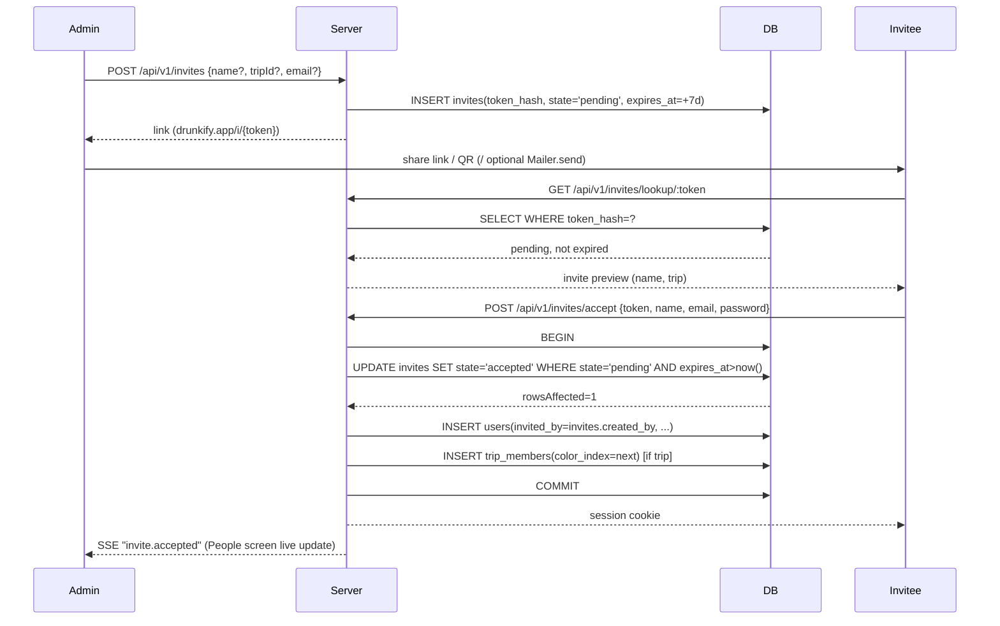

# 04 — Auth and accounts

Binding: README.md (esp. D1–D4, D9, D11, D13, D14, §4 shared contracts) and DESIGN_SPEC.md §6.13/§7. This doc wins over DS §6.13.3/§10 Q7 ("no email in V1") per D3.

## 1. Roles

| Role | Scope | Cardinality | Set by |
|---|---|---|---|
| **App admin** | Whole app | Exactly 1, always | Seeded on boot. Never promoted/demoted in V1. |
| **Trip owner** | Per trip | Exactly 1 per trip | `trips.owner_id`, set to creator at trip creation. |
| **Member** | Per trip | N | `trip_members` row exists for (user, trip). |

Model admin and trip-owner as **separate checks in code** (`user.role === 'admin'` vs `trip.owner_id === user.id`), even though D9 (admin-only trip creation) means **owner always equals admin in V1** — every trip's owner is the admin who created it. Do not hardcode the admin check for owner-gated actions (theme, unlock time, ceremony start): check `trips.owner_id`, so the two stay separable if ownership transfer or multi-admin ever ships (§10 Q10 open question, not V1).

### 1.1 Authorization matrix

| Action | Admin | Trip owner | Member | Endpoint prefix |
|---|:---:|:---:|:---:|---|
| Sign in / sign out | ✓ | ✓ | ✓ | `/api/v1/auth/*` |
| View/edit own profile (name, display theme) | ✓ | ✓ | ✓ | `/api/v1/me` |
| Change own password / email | ✓ | ✓ | ✓ | `/api/v1/auth/change-password`, `/api/v1/auth/change-email` |
| Create trip | ✓ | – | – | (03-api.md, trips) |
| Edit trip settings (theme, unlock time) | – | ✓ | – | (03-api.md, trips) |
| Start ceremony | – | ✓ | – | (03-api.md, trips) |
| Log / edit / delete own drinks on a trip | – | ✓ (as member) | ✓ (if a member of that trip) | (03-api.md, drinks) |
| View leaderboard / feed / predictions for a trip | – | ✓ (as member) | ✓ (if a member of that trip) | (03-api.md) |
| Create invite (with/without trip) | ✓ | – | – | `/api/v1/invites` |
| Reissue / revoke invite | ✓ | – | – | `/api/v1/invites/:id/reissue`, `/api/v1/invites/:id/revoke` |
| Accept invite | anyone with a valid token | | | `/api/v1/invites/accept`, `/api/v1/invites/accept-as-member` |
| View People / invites screen | ✓ | – | – | `/api/v1/people`, `/api/v1/invites` |
| View another user's email | ✓ | – | – (only own) | `/api/v1/people/*` |
| Add existing user to a trip | ✓ | – | – | `/api/v1/people/:userId/trips` |
| Send password reset link for another user | ✓ | – | – | `/api/v1/people/:userId/reset-link` |
| Remove a user's access | ✓ | – | – | `/api/v1/people/:userId` (DELETE) |
| Self-serve forgot password | anyone (unauthenticated, by email) | | | `/api/v1/auth/forgot-password` |
| Be removed | never (admin can't be removed) | ✓ | ✓ | — |

Server checks the role on every request (session → user → `role` / trip membership lookup). The UI hiding a button is not a control (DS §6.13 "Authorisation").

## 2. Admin seeding on boot

Runs once, at server start, before accepting traffic.

```
seedAdminIfNeeded():
  if countUsers() > 0: return                     # fast path, no transaction

  db.transaction(tx =>
    # app_meta is the seed lock. PK/unique on `key` makes this the race-breaker
    # across processes/instances hitting an empty DB at the same instant.
    claimed = tx.exec(
      "INSERT INTO app_meta (key, value, updated_at) VALUES ('admin_seeded', ?, ?)
       ON CONFLICT (key) DO NOTHING", [now(), now()])
    if claimed.rowsAffected == 0: return           # another process won the race; bail

    if tx.countUsers() > 0: return                 # belt-and-braces re-check inside the txn

    password = env.ADMIN_PASSWORD ?? randomPrintable(20)   # A-Za-z0-9, crypto RNG
    hash = argon2id.hash(password)                 # see §4 params
    tx.insertUser({
      id: uuidv7(), email: normalizeEmail(env.ADMIN_EMAIL),
      password_hash: hash, display_name: "Admin", role: "admin",
      must_change_password: true, created_at: now()
    })
  )  # both writes commit together or neither does — no half-seeded state on crash

  if env.ADMIN_PASSWORD is unset:
    log.info(`[SEED] one-time admin password (shown once, will not be logged again): ${password}`)
```

Notes:
- `app_meta(key, value, updated_at)` (matches 02-data-model.md §5.17 — no `created_at` column) — `key` is the PK. `ON CONFLICT (key) DO NOTHING` works identically on `better-sqlite3` (SQLite ≥3.24 upsert syntax) and `pg`. This is the single mechanism relied on for both drivers — no separate SQLite-vs-Postgres branching.
- Wrapping the `app_meta` claim **and** the user insert in one transaction is what makes it crash-safe: if the process dies between claiming the lock and creating the user, the transaction rolls back both, and the next boot retries cleanly. Two writes outside a shared transaction would risk a permanently "seeded" flag with no admin.
- `ADMIN_EMAIL` required in production (server refuses to boot without it). `ADMIN_PASSWORD` optional; when unset, the generated password is printed exactly once and never persisted in logs, only in `users.password_hash`.
- **DB-level backstop**: partial unique index `CREATE UNIQUE INDEX ux_users_one_admin ON users(role) WHERE role = 'admin'` (README C3; SQLite and Postgres both support partial indexes). Guarantees at most one admin exists even if a future code path tries to create a second.
- Seeding never reruns once `app_meta.admin_seeded` exists, regardless of whether the admin user was later removed (it can't be — admin can't be removed, §7).

## 3. Ops CLI

Bundled in the server image at `/usr/local/bin/drunkify` (01-architecture.md §9 — a launcher script: `exec node /app/apps/server/dist/cli.js "$@"`), using the same DB config (env vars) as the running server. Must be run against the **same** `/data` volume as the live container — do not run it from a separate untouched image.

| Command | Args | Behaviour |
|---|---|---|
| `drunkify admin reset-link` | `[--email <email>]` (default: the seeded admin) | Creates a reset token (§8) for that user, prints the full link (`{PUBLIC_URL}/r/{token}`) once to stdout. No UI equivalent — recovery path when the admin is locked out. |
| `drunkify admin set-email` | `<newEmail>` | Updates the admin's email directly (bypasses "current password" rule in §6.13.13, since this is an operator command, not the in-app flow). Validates uniqueness/format. Does not touch sessions. |
| `drunkify admin set-password` | (interactive prompt, hidden input) | Emergency path when email delivery/reset link is also unreachable (e.g. no `PUBLIC_URL` yet). Sets `must_change_password = true` after. Revokes all admin sessions. |
| `drunkify admin whoami` | — | Prints admin email + `must_change_password` state. Debug only. |

Invocation inside Docker:
```
# single-container deploy
docker exec -it drunkify drunkify admin reset-link

# docker compose
docker compose exec app-prod drunkify admin reset-link --email admin@example.com

# local dev (no container)
pnpm --filter server cli -- admin reset-link
```

## 4. Passwords

| Rule | Value |
|---|---|
| Length | 8–128 chars, any characters, no composition rules |
| Common-password check | Reject if in bundled list. File: `apps/server/assets/common-passwords-10k.txt` (README C15; plain, one per line, lowercased, checked against the lowercased candidate). Source it from a public top-10k breached-password list at build time; commit the flat file, don't fetch at runtime. |
| Hash | Argon2id via `@node-rs/argon2` |
| Rehash | On successful sign-in, if the stored hash's params ≠ current `ARGON2_*` config, re-hash with current params and update `password_hash` in the same request (verify succeeded first, so the plaintext is in hand once). |

Argon2id params (Raspberry Pi 4 class box, single instance, D14):
```ts
{
  algorithm: Argon2id,
  memoryCost: 19456,   // 19 MiB
  timeCost: 2,
  parallelism: 1,
  outputLen: 32,
  version: 0x13,
}
```
Justification (one line): OWASP's minimum recommended Argon2id preset (m=19 MiB, t=2, p=1), chosen because a Pi 4's limited RAM and 4 shared cores must still serve concurrent API requests while hashing — `parallelism: 1` avoids one login starving the whole event loop's other work, and 19 MiB keeps memory pressure low if a few logins land at once.

## 5. Sessions

| Property | Value |
|---|---|
| Token | 256-bit random (`crypto.randomBytes(32)`), base64url-encoded (~43 chars) |
| Storage | Only `sha256(token)` (hex) stored in `sessions.token_hash` (unique). Raw token never persisted. |
| Cookie name | `drunkify_session` (README C1, `SESSION_COOKIE_NAME`) |
| Cookie flags | `HttpOnly; Path=/; SameSite=Lax; Secure=<toggle>; Max-Age=7776000` (90 days) |
| Secure toggle | `Secure` on unless `COOKIE_SECURE=false` is explicitly set. Auto-derived from `PUBLIC_URL` scheme (`https://` → secure; `http://` → not secure, e.g. LAN-only deploys behind no TLS) unless `COOKIE_SECURE` overrides it (needed when a reverse proxy terminates TLS and the app itself only sees `http://`). |
| Expiry model | Sliding: `sessions.expires_at = last_used_at + 90d`. No idle timeout (D-per DS: "built for 1 a.m., not a bank"). |
| Renewal throttle | On each authenticated request, if `now - last_used_at > 1h`, update `last_used_at`/`expires_at` **and** re-send `Set-Cookie` with a fresh `Max-Age` (so the browser-side expiry also slides, not just the server row). Otherwise skip the write — avoids a DB write per request. |

Revocation is **soft** (README C39): a session row is marked, never deleted, by any of the triggers below — `sessions.revoked_at` (02-data-model.md §5.2) is the only column that changes. Rows are hard-deleted solely by the scheduler's `sessionCleanup` job, 30 days after `expires_at` or `revoked_at`, whichever applies (01-architecture.md §7). Nothing in this doc deletes a session row outside that job.

| Trigger | Effect |
|---|---|
| Sign out | Set `revoked_at = now()` on this session row only. |
| Password change (self, authenticated) | Set `revoked_at = now()` on all sessions for the user **except** the current one. |
| Password reset (via token, §8) | Set `revoked_at = now()` on **all** sessions for the user, then create one new session for the device completing the reset. |
| Remove access (admin) | Set `revoked_at = now()` on all sessions for the user. Refuse future sign-ins (`users.disabled_at` set). |
| Admin issues a reset link for someone else | No immediate revocation — sessions end only when that link is actually used (falls into the "password reset" row above). |
| Cleanup (README C39) | Scheduler hard-deletes rows 30 days past `expires_at`/`revoked_at`. The only actual `DELETE`. |

**Auth check** (every authenticated request): reject if `revoked_at IS NOT NULL` **or** `expires_at <= now()` — one query, same code path for "explicitly revoked" and "expired via sliding window ran out," both of which are cleaned up together by the same job.

SSE and revocation: `session.revoked` fires on the dedicated `/api/v1/me/events` channel (session auth, README C13, 03-api.md §20) — not multiplexed onto the trip stream. Connections to `/me/events` are keyed by `session_id`. When a session row is soft-revoked (`revoked_at` set) by any of the triggers above, publish `{type: "session.revoked", reason}` on that user's `/me/events` connections; any live connection whose `session_id` now fails the auth check above (revoked or expired — the row itself still exists) sends that event down its stream, then the server closes the connection. Client on receiving `session.revoked`: show `signIn.signedOutBanner`, drop local session state, route to Sign in. `reason ∈ {sign_out, password_changed, password_reset, removed}` (03-api.md §20; `sign_out` covers another tab sharing the same now-revoked session).

## 6. CSRF

- `SameSite=Lax` on the session cookie blocks it from being sent on cross-site POST/PUT/PATCH/DELETE.
- Every mutating request additionally requires header `X-Requested-With: drunkify` (README §4). Missing/wrong value → `400 bad_request` before any handler logic runs (03-api.md §1.1).
- Origin check: if the `Origin` header is present on a mutation, it must equal `PUBLIC_URL`'s origin (scheme+host+port). Mismatch → `400 bad_request`, same as above. If absent (some same-origin requests omit it), the header check above still applies — don't relax it.
- GET/HEAD/OPTIONS exempt (no state change).

## 7. Invite tokens

| Property | Value |
|---|---|
| Entropy | ≥128 bits (`crypto.randomBytes(20)` = 160 bits), base64url |
| Storage | `sha256(token)` in `invites.token_hash` (unique). Raw token never persisted — matches DS §6.13.10 ("links are stored hashed, so an old link can't be shown again"). |
| Expiry | 7 days from `created_at`/reissue |
| Use | Single-use, atomic |
| States | `pending → accepted \| revoked`. **`expired` is virtual** (`state='pending' AND expires_at < now()`), not a stored transition — nothing eagerly flips it (README C5). |

Schema (must match 02-data-model.md §5.3 exactly):
```
invites(
  id text pk, token_hash text unique not null,
  name text null, email text null,           -- optional invite email (README D3b)
  trip_id text null references trips(id),
  created_by text not null references users(id),
  state text not null check (state in ('pending','accepted','revoked')) default 'pending',
  accepted_by text null references users(id), accepted_at integer null,
  created_at integer not null, expires_at integer not null
)
```

Atomic acceptance (README C25): hash the incoming token (`sha256`) **before** opening the transaction — the lookup/lock and writes inside the txn must be the only work holding the lock, so nothing but DB I/O runs while it's held.

```sql
-- SQLite: BEGIN IMMEDIATE first (acquires the write lock up front — no upgrade-deadlock,
-- no SQLITE_BUSY surfaced to the caller as long as busy_timeout is set so a second
-- concurrent acceptance simply waits its turn instead of erroring).
-- Postgres: no BEGIN IMMEDIATE equivalent — take the row lock explicitly first:
--   SELECT id, state, expires_at FROM invites WHERE token_hash = :tokenHash FOR UPDATE
UPDATE invites
SET state = 'accepted', accepted_by = :userId, accepted_at = :now
WHERE token_hash = :tokenHash AND state = 'pending' AND expires_at > :now
-- rowsAffected == 0 → loser: re-select by token_hash to classify per README C41 —
--   no row (unknown token)                          → 404 {code: "invalid_token"}
--   state='revoked'                                  → 410 {code: "token_revoked"}
--   state='accepted'                                 → 410 {code: "token_used"} (never 500, never a raw SQLITE_BUSY)
--   expired (state='pending' AND expires_at <= now)   → 410 {code: "token_expired"}
```
Run this inside the same transaction as user creation (new-account flow) or trip-membership insert (existing-account flow), so a losing race never creates an orphaned account/membership. A SQLite `SQLITE_BUSY` that does surface (timeout exceeded under heavy contention) is retried once with backoff before falling back to the classification above — it must never propagate as a `500`. Matches 03-api.md's `invalid_token`/`token_expired`/`token_used`/`token_revoked` codes exactly (README C41) — do not reintroduce a generic `invite_invalid`.

- **Reissue** ("Share a new link", README C40): allowed only when `state IN ('pending','revoked')` — `UPDATE invites SET state='pending', token_hash=:newHash, expires_at=:now+7d WHERE id=:id AND state != 'accepted'`. Mutates the same row and resets `state` to `pending`, so reissuing a `revoked` invite un-revokes it too, not just an already-pending one. `rowsAffected == 0` (row was `accepted`) → `409 {code: "conflict"}` — an accepted invite is never reissuable. The old token (pending/revoked case) now matches no row (immediate 404 `invalid_token`), and the People list shows one pending invite (not a duplicate).
- **Revoke**: `state='revoked'` (no `revoked_at` timestamp — 02 §5.3 has no such column).
- **Never deleted** (README C5): no cleanup job. Expired/pending state is derived at read time; safe because `invited_by` is copied onto `users` at acceptance time (§9), not read from the invite row later — the People screen's "Invited by {inviter}" never depends on the invite row's visibility.
- **People list default filter** (default `GET /api/v1/invites`, no query param): hides `state='accepted'`, hides `state='revoked'`, and hides `state='pending' AND expires_at < now() - 30d` (the 30-day-after-expiry rule, README C5). Only currently-pending invites (not yet expired, or expired ≤30 days) are shown by default — a query-time filter, never a row deletion.
- Invite email (README D3b): optional `email` field on the Invite sheet; if set, `Mailer.send` fires best-effort in addition to the share/QR link (does not replace them).

## 8. Password reset tokens

Same shape as invite tokens (≥128 bit, base64url, `sha256` stored), different table and lifetimes:

```
password_resets(
  id text pk, token_hash text unique not null,
  user_id text not null references users(id),
  created_by text null references users(id) on delete set null,  -- NULL = self-serve (README C4), set = issuing admin's userId
  created_at integer not null, expires_at integer not null,
  used_at integer null
)
```

- Expiry: 24h.
- **Never deleted** (same policy as invites, README C5): rows are permanent audit history. **New invalidates earlier**: issuing a reset token sets `used_at = now()` on any other unused (`used_at IS NULL`) rows for that user first — only one *active* (unused, unexpired) reset token per user at a time; `used_at` doubles as "invalidated/superseded", not strictly "was redeemed by the user".
- Acceptance is the same atomic-`UPDATE ... WHERE used_at IS NULL AND expires_at > now()` pattern as invites, then: set `users.password_hash`, clear `must_change_password` if set, soft-revoke **all** sessions for the user (§5), create a new session bound to the requesting device.
- If a different account's session cookie is present on this device when the reset completes, it's simply overwritten by the new session cookie (that other account's session row elsewhere is untouched — DS: "signed out" describes this device only).
- `created_by` (README C4) distinguishes self-serve (§10, `NULL`) from admin-issued (People → member sheet → "Send password reset link", or the CLI — set to the admin's `userId`) for audit/analytics; behaviour is identical either way.

## 9. Invite acceptance flows

| Scenario | Behaviour |
|---|---|
| **New account, invite has a trip** | `POST /api/v1/invites/accept` with `{token, name, email, password}` → create user, copy `invited_by = invites.created_by` onto the user row, mark invite accepted (atomic), insert `trip_members` row (color index = next in join order, below), create session, sign in. Land on that trip's Log home, toast `invite.welcomeToast`. |
| **New account, invite has a trip whose ceremony already started** (README C36) | Same atomic accept, **but skip the `trip_members` insert** — a membership add after `ceremony_started_at` is `409 ceremony_started` everywhere else, and invite acceptance doesn't get a silent exception. Response `trip: null`, same as the no-trip case below; land on No trip yet, toast `invite.welcomeToastNoTrip`. The account and invite are still consumed normally. |
| **New account, invite has no trip** | Same, but no `trip_members` insert. Land on No trip yet, toast `invite.welcomeToastNoTrip`. |
| **Existing account, signs in with token** ("Already have an account? Sign in") | Sign-in carries the token. On successful auth, accept the invite for *that* account (same atomic UPDATE + trip join if applicable, same ceremony-started skip above) rather than creating a new user. |
| **Already signed in, invite has a trip** | Show "You're signed in as {name}", primary "Join {trip} as {name}". Accepting **consumes** the invite (state → accepted) and joins the trip — unless that trip's ceremony has started (C36 above), in which case the invite is still consumed but no join happens; show `invite.alreadyMember` instead. |
| **Already signed in, invite has no trip** | Show `invite.alreadyMember` / "Open Drunkify". Invite is **not** consumed (`state` stays `pending`) — it can still be forwarded to the intended person. |
| **Duplicate email on create-account** | `email_taken` field error with `invite.emailTakenAction` ("Sign in instead"), carrying the token to Sign in. Invite is not touched until sign-in completes it. |
| **Duplicate display name on the trip** | Non-blocking hint only (`invite.duplicateName`); does not block submission, no server-side uniqueness on `display_name`. |

**Ceremony freeze** (README C36): once `trips.ceremony_started_at` is set, no code path adds a `trip_members` row for that trip — invite acceptance checks this in the same transaction as the atomic invite-state UPDATE, not as a separate racy pre-check. Prediction windows for the trip are already closed by ceremony start regardless (README C36, §"Predictions" cross-reference in `05-domain-logic.md`).

**Join order / color index** (README C45): `trip_members.color_index` = count of existing members on that trip at insert time — an **unbounded** join ordinal (member #14 gets `13`, no cap, no reuse of a removed member's slot). It is not itself the palette index: palette colour = `color_index % 10` (`color.members.palette` has 10 entries). Assigned once at insert, never reassigned. Race-safety:
- SQLite: single-writer semantics under `BEGIN IMMEDIATE` serialize this naturally — `SELECT COUNT(*) ... ; INSERT ...` inside one transaction is safe.
- Postgres: same transaction, but take a row lock on the trip first (`SELECT id FROM trips WHERE id = :tripId FOR UPDATE`) before the count+insert, or add a unique constraint on `(trip_id, color_index)` and retry once on conflict.

## 10. Self-serve forgot password (README D3, overrides DS §10 Q7)

Flow: `signIn.forgotSheet` gains an email field. `POST /api/v1/auth/forgot-password { email }` **always** returns the same `204` (03-api.md §3), whether or not the email matches an account (account-enumeration avoidance, §14).

```
forgotPassword(email):
  rateLimit.check("forgot:email:" + normalizeEmail(email))
  rateLimit.check("forgot:ip:" + clientIp)
  user = findUserByEmail(email)          # may be null
  if user and not user.disabled_at:
    token = createResetToken(user, createdBy=null)  # NULL = self-serve, README C4
    enqueue: Mailer.send({ to: user.email, ...templates.forgotPassword(link) })  # async, best-effort, fire-and-forget
  return 204  # identical response in every case
```

- Sending is **async / best-effort**: the HTTP response does not wait on SMTP; a mailer failure is logged server-side and never surfaces to the caller.
- If `MAILER=log`, the admin can retrieve the link from server logs (stdout) — documented as the intended recovery path for a single self-hosted admin with no real SMTP configured.
- Rate limited per email **and** per IP (§13).

## 11. Mailer (README D3)

Interface (`packages/server/mailer`):
```ts
interface Mailer {
  send(msg: { to: string; subject: string; text: string; html?: string }): Promise<void>;
}
```

| Env var | Values | Notes |
|---|---|---|
| `MAILER` | `log` (default) \| `smtp` | |
| `SMTP_HOST` | hostname | required if `MAILER=smtp` |
| `SMTP_PORT` | port | default `587` |
| `SMTP_SECURE` | `true`/`false` | implicit TLS (465) vs STARTTLS (587) |
| `SMTP_USER` | string | optional (open relays exist) |
| `SMTP_PASS` | string | optional |
| `MAIL_FROM` | `"Drunkify <noreply@example.com>"` | required if `MAILER=smtp` |

- `MAILER=smtp` → nodemailer transport built from the vars above.
- `MAILER=log` → writes to stdout, one line prefixed `[MAIL]`, format:
  ```
  [MAIL] to=<email> subject="<subject>"
  <text body, indented>
  ```
  This is the one place email bodies (containing reset/invite links) are intentionally logged — see §14 redaction.
- Failure handling: `send()` rejections are caught at the call site, logged (`level=warn, event=mail_send_failed, to=<redacted?>`), never thrown into the request path. Sending is fire-and-forget from the caller's perspective (§10).
- Templates (voice: `auth.json`'s "plain, warm, short"):

| Template | Subject | Text body |
|---|---|---|
| `forgotPassword` | "Reset your Drunkify password" | "Hi,\n\nSomeone asked to reset the password for this Drunkify account. If that was you, set a new one here:\n\n{link}\n\nThis link works once and lasts 24 hours. If it wasn't you, ignore this email." |
| `invite` | "{inviter} invited you to Drunkify" | "Hi{, name},\n\n{inviter} invited you to Drunkify{ — join them on {trip}}.\n\n{link}\n\nWorks once. Expires {date}." |

### 11.1 New content keys (`packages/content/auth.json`)

| Key | Purpose | Sample copy |
|---|---|---|
| `signIn.forgotSheet.cta` | changes from "Got it" to a submit action | "Send reset link" |
| `signIn.forgotSheet.body` | replaces "ask your admin" copy | "Enter your email and we'll send you a link, if you have an account." |
| `signIn.forgotSheet.sentTitle` | shown after submit | "Check your email" |
| `signIn.forgotSheet.sentBody` | always-same success copy (D3) | "If that's a Drunkify account, we've sent a link. It works once and lasts 24 hours." |
| `signIn.forgotSheet.sentBodyLogHint` | shown only when `MAILER=log` (admin-facing build, not end-user prod) | "No mail server configured — check the server log for the link." |
| `email.forgotPassword.subject` | mailer | "Reset your Drunkify password" |
| `email.forgotPassword.body` | mailer, plaintext | see §11 table |
| `email.invite.subject` | mailer | "{inviter} invited you to Drunkify" |
| `email.invite.body` | mailer, plaintext | see §11 table |
| `inviteSheet.emailLabel` | new optional field on Invite sheet Create state | "Email it too (optional)" |
| `inviteSheet.emailSent` | confirmation toast | "Emailed to {email}" |

Existing `signIn.forgotSheet.title` unchanged. `linkProblem.resetExpired` unchanged (still applies to self-serve and admin-issued reset links alike).

## 12. Identity rules

- Email: trimmed, lower-cased, unique (`users.email` unique index on the normalized value — normalize before insert/lookup, don't rely on a case-insensitive collation). Never verified, never used for anything but sign-in + optional mail delivery.
- Display name: 1–24 chars, not unique (no DB constraint; duplicate handling is UI-only hint, §9).
- Visibility: email shown only to the admin (People screen, member sheet) and to the user themself (Account screen). Never included in any trip-scoped API response (feed, leaderboard, members list for non-admins) — omit the field entirely server-side for non-admin/non-self callers, don't just hide it client-side.

## 13. Rate limits (in-memory sliding window, D14)

Single-instance assumption (D14) — an in-process `Map<key, timestamp[]>`, pruned to the window on each check. `rate_limit_events` table exists in the schema (README §4) but is **unused in V1**; reserved for a future multi-instance backend.

| Limit | Window | Key(s) | Response on exceed |
|---|---|---|---|
| Sign-in failures | 5 / 15 min | `signin:email:<email>` **and** `signin:ip:<ip>` (either tripping blocks) | `429 { error: { code: "rate_limited", retryAfter } }` |
| Forgot-password | 5 / 15 min (suggest lower, e.g. 3/hour, to blunt mail-bombing) | `forgot:email:<email>` and `forgot:ip:<ip>` | same 204 regardless (§10) — the limiter just stops enqueuing the send past the cap; response doesn't change (still no enumeration signal) |
| Token lookups (invite/reset GET-by-token) | 20 / 15 min | `token:ip:<ip>` | `429 rate_limited` |
| Invite creation | 60 / hour | `invite_create:admin` (single admin, so effectively a global cap against runaway loops/bugs) | `429 rate_limited` |

`retryAfter` (seconds) always included per README §4 error shape.

IP extraction: `TRUST_PROXY` env (boolean or CIDR list, mirrors Fastify's `trustProxy` option). When unset/false, use the raw socket address — never trust `X-Forwarded-For` from an untrusted edge, or rate limits (and audit) become spoofable. Set `TRUST_PROXY=true` (or the proxy's CIDR) only when a reverse proxy is known to strip/overwrite that header.

## 14. Remove access (README D11)

- Sets `users.disabled_at = now()` (README C3). Sign-in for a disabled account: wrong password → generic `bad_credentials` (same as any account); **correct** password on a disabled account → `403 account_disabled` (README C17) — a deliberate, distinguishable signal, not blanket enumeration-avoidance, since the admin already knows the account was disabled.
- Soft-revokes all sessions for the user (§5) — rows persist until the 30-day cleanup job (README C39).
- Invalidates any pending `password_resets` for the user: sets `used_at = now()` on unused rows (never deleted, §8).
- Their `drinks`, `achievement_unlocks`, `predictions`, `trip_members` rows are untouched — still counted in metrics/leaderboards/awards (D11).
- Admin cannot be removed: `DELETE /api/v1/people/:userId` returns `403 forbidden` (`cannot_remove_admin`) if `userId` is the admin (03-api.md §6).

## 15. Offline queue interaction (README D7)

- Client stores each queued drink in IndexedDB with the `userId` of the session that created it (not just the drink payload).
- On successful sign-in, the client compares the *new* session's `userId` to each queued item's `userId`:
  - Match → flush (idempotent create via client-generated UUIDv7, §README).
  - No match → leave queued untouched (don't discard, don't flush under the wrong account). It flushes later if that original account signs back in on this device.

## 16. Security checklist

- **Headers**: CSP built at boot, incorporating `MAP_STYLE_URL`'s origin **and** `MAP_CSP_ORIGINS`:
  ```
  default-src 'self';
  script-src 'self';
  style-src 'self' 'unsafe-inline';
  img-src 'self' data: blob: <MAP_STYLE_URL origin> <MAP_CSP_ORIGINS>;
  connect-src 'self' <MAP_STYLE_URL origin> <MAP_CSP_ORIGINS>;
  worker-src 'self' blob:;
  font-src 'self' data:;
  frame-ancestors 'none';
  base-uri 'none';
  form-action 'self';
  ```
  `MAP_CSP_ORIGINS` (env, comma-separated list; default `https://tiles.openfreemap.org` — OpenFreeMap's tile/glyph/sprite origin) is merged into `img-src` and `connect-src` so a style whose tiles/glyphs/sprites live on a host different from `MAP_STYLE_URL` itself still loads under MapLibre (`worker-src 'self' blob:` already covers MapLibre's blob-URL worker, no origin merge needed there). See 01-architecture.md §4 for the env var; set it explicitly when self-hosting a style with assets split across hosts.
  `style-src 'unsafe-inline'` accepted for MapLibre GL's inline canvas styling and React inline `style` attrs; tighten with a nonce later if desired. HSTS (`Strict-Transport-Security`) sent only when `PUBLIC_URL` is `https://` (optional/no-op on plain-HTTP LAN deploys).
- **Timing-safe compares**: never compare a raw incoming token to a stored value directly. Always `sha256(incoming)` then do an indexed DB lookup (`WHERE token_hash = ?`) — this sidesteps timing side-channels entirely rather than requiring `crypto.timingSafeEqual` in app code. Argon2id's own `verify()` is already constant-time for password checks.
- **Generic errors**: wrong email/password → one message (`badCredentials`), no "which field" hint. Forgot-password → always identical success response. Disabled-account sign-in with a **wrong** password → same `bad_credentials` as any other failure; with the **correct** password → `403 account_disabled` (README C17 — the one deliberate exception to blanket generic-failure behaviour, see §14).
- **Logging redaction**: never log raw session/invite/reset tokens, `password_hash`, or plaintext passwords — with two intentional, documented exceptions: (1) `MAILER=log` output includes the reset/invite link in full (§11), (2) the one-time seeded admin password is printed once at boot (§2). Both are called out in code comments at the log call site so they aren't "fixed" by a future redaction pass. Tokens embedded in **request-log URLs** (`/i/:token`, `/r/:token`, `/api/v1/invites/lookup/:token`, `/api/v1/auth/reset-password/:token`) are a separate concern from the exceptions above and are always redacted — see 01-architecture.md §8 (Fastify request-logging serializer) and the reverse-proxy access-log note there; this applies regardless of `MAILER` mode.
- **Account enumeration avoidance**: sign-in and forgot-password never reveal whether an email exists. Deliberate, documented exception: create-account's "email already registered → Sign in instead" (DS §6.13.6) — acceptable because the app is invite-only and closed to a known friend group; the UX win outweighs the (low) enumeration risk in that single flow.

## 17. Sequence diagrams

### 17.1 First-run admin

```mermaid
sequenceDiagram
    participant Op as Operator
    participant Srv as Server (boot)
    participant DB
    participant Adm as Admin (browser)

    Srv->>DB: countUsers()
    DB-->>Srv: 0
    Srv->>DB: BEGIN; INSERT app_meta('admin_seeded') ON CONFLICT DO NOTHING
    DB-->>Srv: claimed
    Srv->>Srv: password = ADMIN_PASSWORD ?? random(20)
    Srv->>DB: INSERT users(admin, must_change_password=true); COMMIT
    Srv-->>Op: log "[SEED] admin password: ..." (if generated)
    Adm->>Srv: POST /api/v1/auth/sign-in {email, password}
    Srv-->>Adm: session cookie, mustChangePassword=true
    Adm->>Srv: GET Finish setting up (forced route)
    Adm->>Srv: POST /api/v1/auth/finish-setup {name, email, newPassword}
    Srv->>DB: UPDATE users SET must_change_password=false, ...
    Srv-->>Adm: 200, land on No trip yet (admin)
```

### 17.2 Invite → create account



### 17.3 Forgot-password via email

```mermaid
sequenceDiagram
    participant U as User
    participant Srv as Server
    participant DB
    participant M as Mailer

    U->>Srv: POST /api/v1/auth/forgot-password {email}
    Srv->>Srv: rate limit check (email + IP)
    Srv->>DB: findUserByEmail(email)
    alt user exists and not disabled
        Srv->>DB: UPDATE old unused password_resets SET used_at=now(); INSERT new (created_by=NULL, expires_at=+24h)
        Srv-->>M: enqueue send(forgotPassword template) [async, best-effort]
    end
    Srv-->>U: 204 (identical response either way)
    M-->>U: email with reset link (or [MAIL] log line if MAILER=log)

    U->>Srv: POST /api/v1/auth/reset-password {token, newPassword}
    Srv->>DB: UPDATE password_resets SET used_at WHERE used_at IS NULL AND expires_at>now()
    alt token invalid, used, or expired
        Srv-->>U: 404/410 invalid_token | token_expired (README C41, 03-api.md §1.9)
    else
        Srv->>DB: UPDATE users SET password_hash=...
        Srv->>DB: UPDATE sessions SET revoked_at=now() for user; INSERT new session
        Srv-->>U: session cookie, "signed out everywhere else"
    end
```

### 17.4 Admin-issued reset

```mermaid
sequenceDiagram
    participant Adm as Admin
    participant Srv as Server
    participant DB
    participant Mem as Member (out of band)

    Adm->>Srv: POST /api/v1/people/:userId/reset-link
    Srv->>DB: UPDATE old unused password_resets for :userId SET used_at=now(); INSERT new (created_by=adminId, expires_at=+24h)
    Srv-->>Adm: link (drunkify.app/r/{token})
    Adm->>Mem: share link (chat/QR — not emailed by this endpoint)
    Note over Mem,Srv: same as §17.3 from "POST reset-password" onward
    Mem->>Srv: POST /api/v1/auth/reset-password {token, newPassword}
    Srv-->>Mem: signed in on this device; all other sessions for :userId ended
```

## 18. Endpoints — must match 03-api.md

| Method | Path | Auth | Purpose |
|---|---|---|---|
| POST | `/api/v1/auth/sign-in` | none | email+password → session cookie; `403 account_disabled` if correct password but disabled (README C17) |
| POST | `/api/v1/auth/sign-out` | session | soft-revoke current session (`revoked_at`, §5) |
| POST | `/api/v1/auth/finish-setup` | session (`mustChangePassword=true` only) | `{name, email, newPassword}` → clears the flag |
| POST | `/api/v1/auth/forgot-password` | none | §10, always `204` |
| GET | `/api/v1/auth/reset-password/:token` | none | always `200` (README C41): `{email}` or `LinkProblem{kind}` (`invalid`/`resetExpired`/`used`); rate-limited per IP |
| POST | `/api/v1/auth/reset-password` | none | `{token, newPassword}` → §8 |
| POST | `/api/v1/auth/change-password` | session | `{currentPassword, newPassword}`, revokes every other session |
| POST | `/api/v1/auth/change-email` | session | `{currentPassword, newEmail}` |
| GET | `/api/v1/me` | session | own profile incl. email and `mustChangePassword` (canonical "current user" endpoint — no separate `/auth/me`) |
| PATCH | `/api/v1/me` | session | `{name?, displayThemePref?}` |
| POST | `/api/v1/invites` | admin | create invite |
| GET | `/api/v1/invites` | admin | list (People screen) |
| POST | `/api/v1/invites/:id/reissue` | admin | only when `state != 'accepted'` (README C40); kills old token, issues new (same row, new `token_hash`/`expires_at`, §7); `409 conflict` if already accepted |
| POST | `/api/v1/invites/:id/revoke` | admin | state → revoked |
| GET | `/api/v1/invites/lookup/:token` | none | always `200` (README C41): preview (name/trip), or `LinkProblem{kind}` (`invalid`/`expired`/`used`/`revoked`) |
| POST | `/api/v1/invites/accept` | none | `{token, name, email, password}` → §9 |
| POST | `/api/v1/invites/accept-as-member` | session | `{token}` → §9 |
| GET | `/api/v1/people` | admin | People screen: members |
| GET | `/api/v1/people/:userId` | admin | member sheet |
| POST | `/api/v1/people/:userId/trips` | admin | add existing user to a trip |
| POST | `/api/v1/people/:userId/reset-link` | admin | §8/§17.4 |
| DELETE | `/api/v1/people/:userId` | admin | remove access, §14 |
